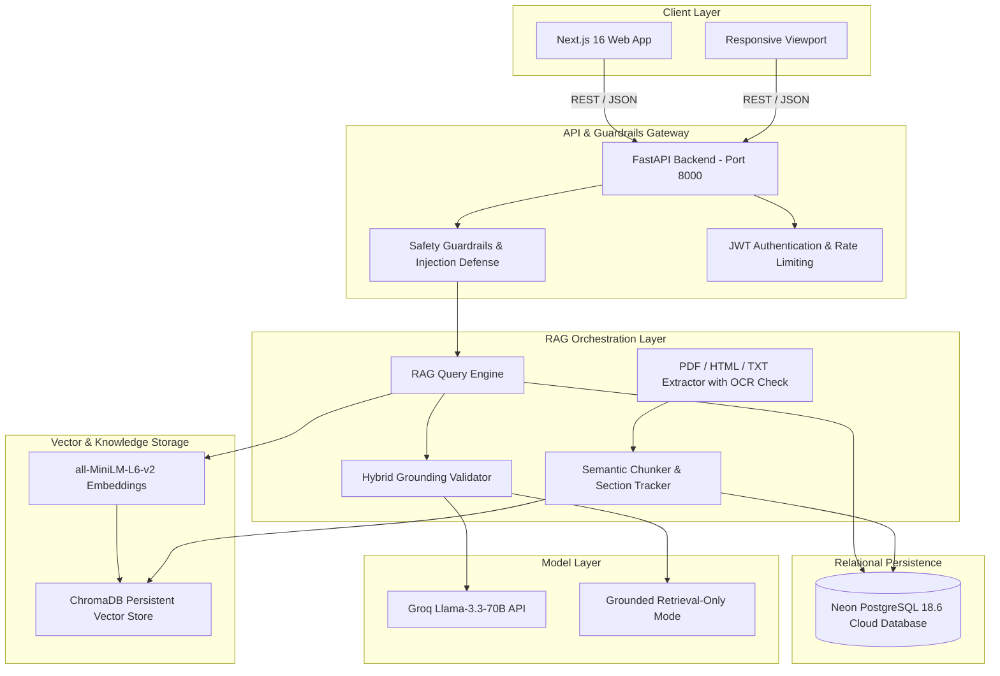
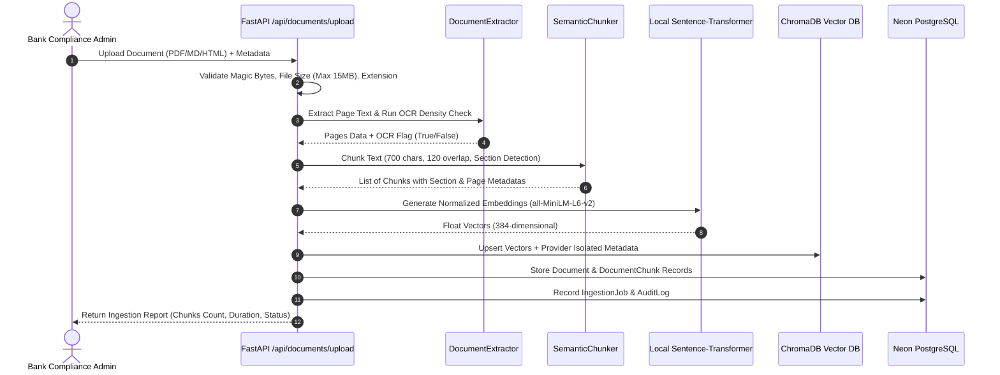
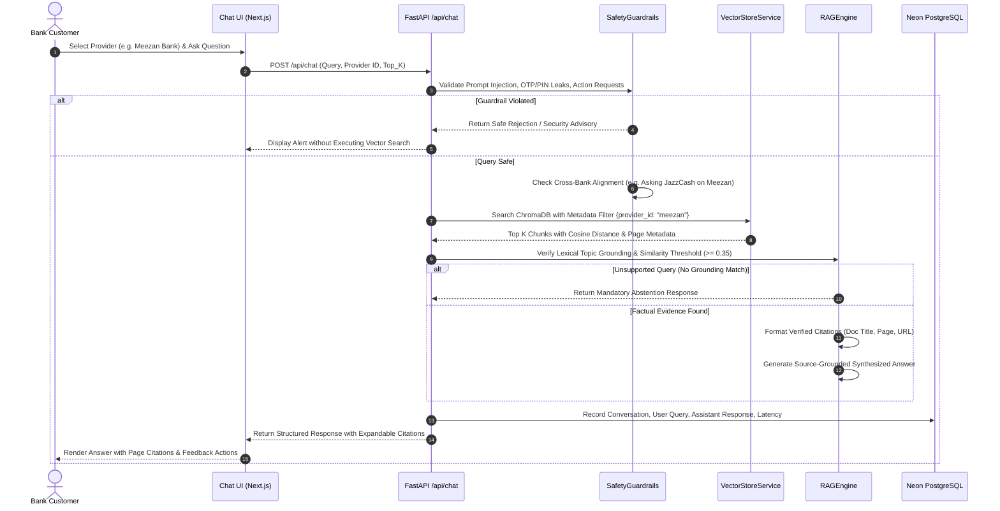

# BankMate AI — System Architecture & Workflow Specifications

## 1. High-Level Architecture Overview

BankMate AI is designed as a decoupled, multi-bank intelligent retrieval-augmented generation (RAG) platform tailored for Pakistani banking institutions and State Bank of Pakistan (SBP) regulatory standards.

---

## 2. Ingestion Pipeline Sequence

The document ingestion pipeline processes public regulatory and bank documents, calculating content hashes, chunking with section awareness, generating local embeddings, and indexing them into ChromaDB and Neon PostgreSQL.

---

## 3. RAG Query & Strict Provider Isolation Sequence

---

## 4. Key Design Decisions

1. **Provider Isolation**:
   Every chunk in ChromaDB is indexed with strict metadata `provider_id`. Queries targeting a specific bank execute filtered vector search, preventing fees or rules from leaking between financial competitors.
2. **Mandatory Abstention Policy**:
   If a question concerns topics unsupported by the official evidence (e.g. cryptocurrency, stocks, CEO salaries), the system triggers explicit abstention:
   > *"I couldn't verify this information in the available official documents. Please consult the provider's official website or verified support channel."*
3. **Dual Execution Mode**:
   - **Mode A (Grounded Retrieval-Only)**: Zero API key dependency. Verbatim extracts with page proof.
   - **Mode B (Groq Generative Mode)**: Configurable when `GROQ_API_KEY` is provided.
4. **Neon PostgreSQL Cloud Storage**:
   Persistent cloud database storing conversation histories, message logs, document metadata, audit logs, and analytics.
