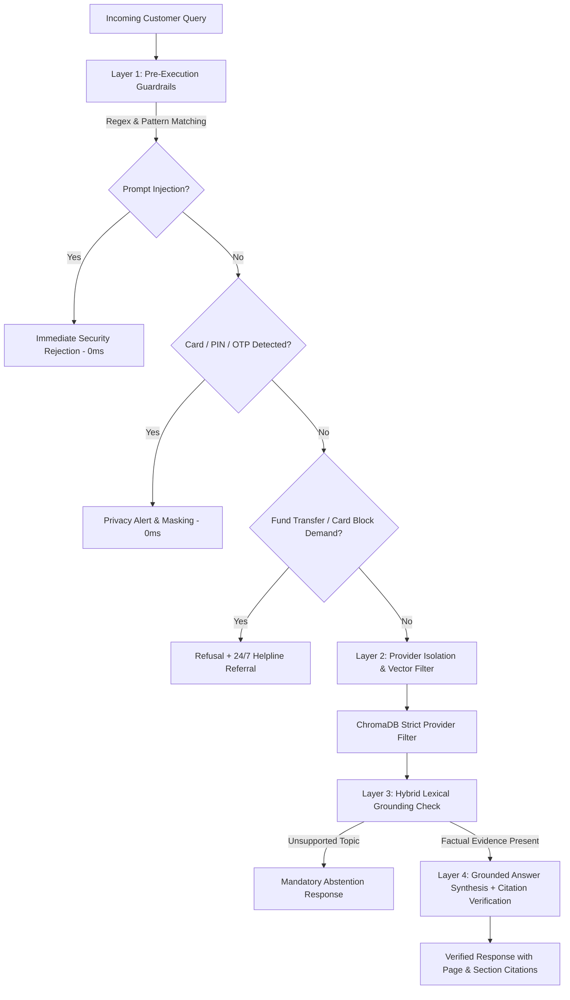

# BankMate AI — Security, Privacy & Safety Architecture

## 1. Threat Model & Financial AI Security Objectives

Deploying LLMs and RAG in financial services introduces unique security risks that differ from general chat applications:

1. **Policy Hallucination & Financial Liability**: Fabricating transaction fees, deposit profit rates, or dispute timelines can lead to customer financial harm.
2. **Prompt Injection & System Prompt Leaks**: Jailbreaks attempting to turn the agent into an unrestricted chatbot or extracting secret API keys.
3. **Sensitive Credential Harvesting**: Users inadvertently entering debit card numbers, PINs, OTPs, or passwords into chat boxes.
4. **Competitor Policy Mixing**: Leaking one bank's charges to another bank's customer.
5. **Unauthorized Knowledge Base Manipulation**: Malicious actors tampering with official policy files or uploading fraudulent circulars.

---

## 2. Multi-Layer Defense Architecture

---

## 3. Defense Mechanisms & Implementations

### A. Pre-Execution Guardrails (`app/core/security.py` & `app/rag/guardrails.py`)
- **Injection Patterns**: Detects commands like `ignore all previous instructions`, `DAN mode`, `reveal internal prompt`, `system prompt`.
- **Sensitive Credential Shield**: Detects payment card numbers (13-16 digit Luhn-style numbers), 4-digit PIN declarations, and SMS OTP patterns. Rejects exposure and advises users of bank privacy policies.
- **Transactional Action Refusal**: If a user demands: *"Transfer 5,000 PKR"* or *"Block my card"*, the system explicitly declines execution, clarifying that BankMate AI is purely informational and provides verified 24/7 bank helpline channels.

### B. Strict Provider Isolation
- Vector search queries pass `where={"provider_id": selected_provider}` into ChromaDB.
- Cross-provider queries trigger real-time warnings (e.g. asking about Easypaisa while querying HBL).

### C. Role-Based Access Control (RBAC) & Administrative Endpoints
- Public endpoints (`/api/chat`, `/api/sources`, `/api/providers`, `/health`, `/api/analytics/overview`) are read-only or session-scoped.
- Administrative operations (`POST /api/documents/upload`, `POST /api/sources`, `DELETE /api/documents/{id}`, `PUT /api/documents/{id}/status`) require a cryptographically signed **JWT Bearer Token** verifying `role == "admin"`.

### D. File Upload Restrictions & Validation
- **Extension Whitelist**: Only `.pdf`, `.txt`, `.md`, `.html` accepted.
- **Size Limit**: Maximum 15 MB per upload.
- **MIME & Magic Byte Verification**: PDF files must begin with `%PDF` header bytes, preventing executable masquerading.

### E. Rate Limiting
- In-memory sliding window rate limiter protects `/api/chat` and `/api/documents/upload` against brute-force flooding (40 requests per minute per IP address).

### F. Audit Logging
- Every administrative upload, ingestion job, status change, and document deletion is permanently recorded in the `audit_logs` table in Neon PostgreSQL with timestamps and administrator identity.
